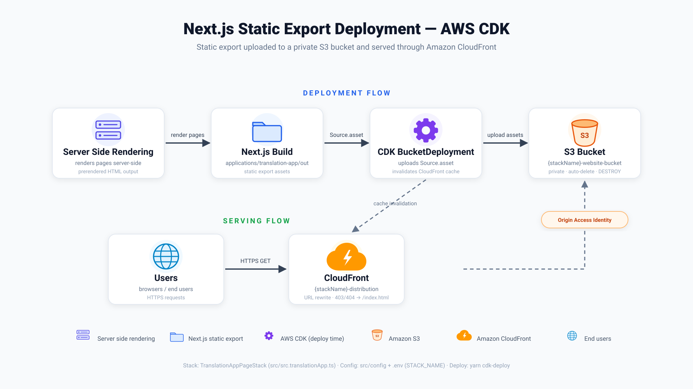

# aws-nextjs-static-deploy

AWS CDK stack that deploys a Next.js static export to a private S3 bucket served through Amazon CloudFront.



## Stack

- **Server Side Rendering** — pages are rendered server-side before the Next.js static export build
- **S3** — private website bucket (`blockPublicAccess: BLOCK_ALL`, auto-delete objects, `DESTROY` removal policy)
- **CloudFront** — distribution with:
  - Origin Access Identity (bucket read access only through CloudFront)
  - Viewer-request function that rewrites URLs (Next.js routing: `/path` → `/path.html`, `/` → `/index.html`)
  - 403/404 error responses → `/index.html`
  - Cache invalidation on every deploy
- **BucketDeployment** — uploads the Next.js build output to the bucket

## Project structure

```
.
├── cdk.json                          # CDK app entry config
├── diagram.svg                       # Architecture diagram
└── src/
    ├── src.awsStack.ts               # CDK app entry point
    ├── src.translationApp.ts         # TranslationAppPage stack
    ├── config/config.app.ts          # App config (appName, stackName, region, appPath)
    ├── constants/constants.resources.ts
    ├── utils/utils.env.ts            # .env loader
    └── lib/
        ├── s3/                       # S3 resources
        └── cloudfront/               # CloudFront resources
```

## Prerequisites

- Node.js + Yarn
- AWS credentials configured

## Setup

Configure `.env` in the project root:

```
STACK_NAME=translation-api
AWS_REGION=us-east-1
```

`STACK_NAME` and `AWS_REGION` are read via `src/config/config.app.ts` and used to name all resources (`${stackName}-website-bucket`, `${stackName}-distribution`, ...).

The Next.js static export must exist at `appPath` (`src/config/config.app.ts`).

## Commands

```bash
yarn cdk-synt    # synthesize the stack
yarn cdk-deploy  # deploy all stacks
```

Destroy: `npx cdk destroy --all`

See `AGENTS.md` for project conventions.
